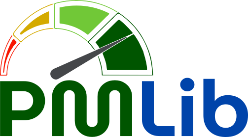

<p align="center">
  
</p>

<p align="center"><b>Power Measurement Library</b></p>

<p align="center">
  <a href="LICENSE"></a>
  
  
  
</p>

PMLib is a modular, open-source power measurement library to investigate the
power and energy usage of high-performance computing applications. A
lightweight server runs next to one or more power meters (or on a board with
on-board power sensors, such as an NVIDIA Jetson), and applications use a
small client library to start and stop measurement *counters* around the code
they want to measure and fetch the power samples afterwards.

## How it works

PMLib follows a **client/server** model over TCP:

- The **server** (`pmlib_server`) owns the measurement hardware. A JSON file
  describes the available *devices* (a Jetson board's sensors, an LMG450
  power analyzer, ...) and the *lines* each device exposes (one per power
  rail or outlet). It samples every line continuously.
- **Clients** connect to the server and open *counters*: named measurement
  sessions over a chosen subset of lines. A counter can be started, stopped,
  restarted and read back, so an application can bracket a region of code
  with `pm_start_counter` / `pm_stop_counter` and later fetch the power
  samples and energy for that region. Several counters can share a device.

```
 ┌──────────────┐ JSON config ┌─────────────────────────┐
 │ pmlib_server │────────────▶│ devices (Jetson boards, │
 │  (server/)   │             │ LMG, WattsUp, Dummy...) │
 └───────┬──────┘             └─────────────────────────┘
         │ TCP
         ▼
 ┌─────────────┐
 │  client app │  pm_set_server / pm_create_counter / pm_start_counter
 │ (your code) │  pm_stop_counter / pm_get_counter_data / pm_print_data_csv
 └─────────────┘
```

## Repository layout

```
PMLib/
├── server/               The measurement server (C++17)
│   ├── pmlib/            Server, counter and device sources
│   │   └── devices/      One driver per supported device type
│   ├── stxxl/            Vendored STXXL, used for on-disk sample storage
│   └── settings-*.json   Example configurations, one per board/device
├── client/               Client library linked into applications
│   ├── *.c, pmlib.h      C API (libpmlib.so)
│   ├── pmlib.py          Python wrapper around libpmlib.so
│   ├── pm_info           Command-line tool to inspect a running server
│   └── test/             C and Python usage examples
├── tests/                End-to-end smoke test (server + C and Python clients)
└── docs/                 Doxygen configuration output and assets
```

## Supported devices

The `"type"` column is the value to use in the JSON configuration.

| Device | `"type"` | Lines | Status |
|---|---|---|---|
| NVIDIA Jetson Nano | `Nano` | 3 | Supported (on-board INA3221 via sysfs) |
| NVIDIA Jetson TX2 | `TX2` | 12 | Supported (on-board INA3221 via sysfs) |
| NVIDIA Jetson AGX Xavier | `Xavier` | 6 | Supported (on-board INA3221 via sysfs) |
| NVIDIA Jetson AGX Orin | `Orin` | 4 | Supported (on-board INA3221 via sysfs) |
| NVIDIA Jetson Orin Nano | `OrinNano` | 4 | Supported (on-board INA3221 via sysfs) |
| NVIDIA Jetson AGX Thor | `Thor` | 4 | Supported (on-module INA3221 + carrier-board INA238 for total power, via sysfs) |
| NVIDIA GPUs via NVML (e.g. DGX Spark GB10) | `NVML` | 1 | Supported (GPU power draw as in `nvidia-smi`). On the DGX Spark it is the GPU only and NVML refreshes it about once per second |
| Hardkernel Odroid-XU3 | `OdroidXU3` | 4 | Supported (on-board INA231 sensors) |
| WattsUp? Pro | `WattsUp` | 1 | Ported from the old Python server, **not yet validated on hardware** |
| ZES Zimmer LMG450 | `LMG450` | 4 | Ported from the old Python server, **not yet validated on hardware** |
| ZES Zimmer LMG500 | `LMG500` | 8 | LMG450 protocol extended to 8 lines, **unverified** |
| AccelPower CAPE | `APCape-8L` | 8 | Experimental, build with `-DUSE_DEVICE_APCAPE=ON` |
| ArduPower | `ArduPower` | 16 | Not implemented yet (the driver is a placeholder) |
| Dummy (fake data) | `Dummy` | 24 | For testing without hardware |

The board drivers read the sensors through paths that depend on the kernel
(sysfs/hwmon numbering); see the comment at the top of each file in
`server/pmlib/devices/` for the exact paths and the expected `"url"`.

## Building

Dependencies (Debian/Ubuntu):

```bash
sudo apt-get install build-essential cmake libboost-all-dev
```

### Server

```bash
git clone https://github.com/hpca-uji/PMLib.git
cd PMLib/server
cmake -B build
cmake --build build -j
```

This produces `server/build/pmlib_server`. Requirements: CMake ≥ 3.15 (CMake 4
works), a C++17 compiler and Boost (`system`, `filesystem`, `thread`,
`coroutine`, `log`). For the AccelPower CAPE driver, also install
`libi2c-dev` and configure with `cmake -B build -DUSE_DEVICE_APCAPE=ON`.

### Client

```bash
cd PMLib/client
make                                  # builds libpmlib.so
make PREFIX=$HOME/pmlib install       # optional: installs the library and headers
```

The Python client additionally needs NumPy, and `libpmlib.so` must be in the
current directory or on `LD_LIBRARY_PATH`.

## Configuring the server

The server reads a JSON file. For example, `server/settings-nano.json` for a
Jetson Nano:

```json
{
    "server_ip"      : "127.0.0.1",
    "server_port"    : 6526,
    "server_logfile" : "pmlib_%N.log",

    "computers" : {
        "Jetson-AGX2" : { "ip" : "0.0.0.0" }
    },

    "devices" : {
        "Jetson-Nano" : { "type" : "Nano", "url": "/sys/bus/i2c/drivers/ina3221x/",
            "lines" : {
                "POM_5V_IN"  : { "number" : 0, "voltage": 19, "description" : "POM_5V_IN" },
                "POM_5V_GPU" : { "number" : 1, "voltage": 19, "description" : "POM_5V_GPU" },
                "POM_5V_CPU" : { "number" : 2, "voltage": 19, "description" : "POM_5V_CPU" }
            }
        }
    }
}
```

- `server_ip`, `server_port`: where the server listens (defaults `0.0.0.0`, `6526`).
- `server_logfile`: log file name pattern (default `pmlib_%N.log`, in the
  directory the server is started from). Older example files used
  `log_filename`, which the server never read.
- `devices`: one entry per device. `type` selects the driver (table above),
  `url` is where the driver reads from (a serial port, a sysfs directory...).
  A device must define exactly as many `lines` as its driver has, numbered
  from 0.
- Lines accept `number`, `voltage`, `description` and, depending on the
  device, `computer`, `metric`, `slope` and `offset`.

Each driver samples at a fixed rate (10 Hz for the Jetson and Odroid boards).
The `max_freq` field that appears in the example files is not read by the
server; a client can still ask for a lower rate when it creates a counter.

Example configurations for each board are in `server/settings-*.json`.

## Usage

### 1. Start the server

```bash
cd PMLib/server
sudo ./build/pmlib_server --configfile settings-nano.json
```

`sudo` is usually needed to read the on-board sensors. Add `--daemonize` to
run it in the background.

### 2. Check it with `pm_info`

```bash
cd PMLib/client
./pm_info -s 127.0.0.1:6526 -l -c        # list devices, lines and open counters
./pm_info -s 127.0.0.1:6526 -r Jetson-Nano   # stream live samples (Ctrl-C to stop)
```

### 3. Measure from your application

**C** — link with `-lpmlib`:

```c
#include <unistd.h>
#include "pmlib.h"

int main(void) {
    server_t server;
    counter_t counter;
    line_t lines;

    pm_set_server("127.0.0.1", 6526, &server);
    pm_set_lines("0-2", &lines);                    /* measure lines 0, 1 and 2 */
    pm_create_counter("Jetson-Nano", lines, /*aggregate=*/1, /*interval=*/0,
                      server, &counter);

    pm_start_counter(&counter);
    sleep(2);                                        /* ... code to measure ... */
    pm_stop_counter(&counter);

    pm_get_counter_data(&counter);
    pm_print_data_csv("region.csv", counter, lines, /*set=*/-1);
    pm_finalize_counter(&counter);
    return 0;
}
```

More examples in `client/test/`.

**Python** — see `client/pmlib_example.py` for a complete example:

```python
import time
import pmlib

p = pmlib.PMLib("127.0.0.1", 6526)
p.create_lines("0-2")
p.create_counter("Jetson-Nano", 1, 0)

p.start_counter()
time.sleep(2)                                         # ... code to measure ...
p.stop_counter()

p.get_counter_data()
print(p.get_joules(p.times[0], p.times[-1]))          # energy, in joules
p.finalize_counter()
```

## Testing

Without any hardware, `tests/run_smoke_tests.sh` starts the server with the
`Dummy` device and checks the C and Python clients against it:

```bash
cmake -S server -B build && cmake --build build -j
make -C client
tests/run_smoke_tests.sh build/pmlib_server
```

The same test runs in GitHub Actions on every push.

## Documentation

API documentation for the server sources is generated with
[Doxygen](https://www.doxygen.nl/): run `doxygen Doxyfile` from the repository
root and open `docs/html/index.html`.

## Citation

If you use PMLib in academic work, please cite:

> S. Barrachina, M. Barreda, S. Catalán, M. F. Dolz, G. Fabregat, R. Mayo,
> E. S. Quintana-Ortí. *"An integrated framework for power-performance
> analysis of parallel scientific workloads."* 3rd International Conference
> on Smart Grids, Green Communications and IT Energy-aware Technologies
> (ENERGY 2013).

## Contributing

Development happens in the group's internal repository, which is mirrored
automatically to https://github.com/hpca-uji/PMLib. Bug reports and pull
requests are welcome on GitHub; accepted changes are integrated in the
internal repository and reach GitHub through the mirror, so a pull request is
closed rather than merged once its changes appear on `main`.

When changing a device driver under `server/pmlib/devices/`, please say in the
pull request which physical device you tested it on, since drivers cannot be
exercised in CI.

## License

PMLib is distributed under the [GNU Lesser General Public License v3.0](LICENSE).

## Author

[Manuel F. Dolz](https://sites.google.com/uji.es/manuel-f-dolz/) — Universitat Jaume I, with contributions from the members of the group listed in the commit history.
